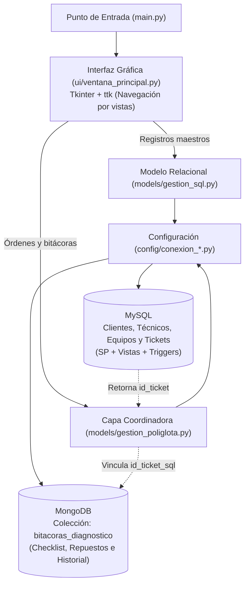
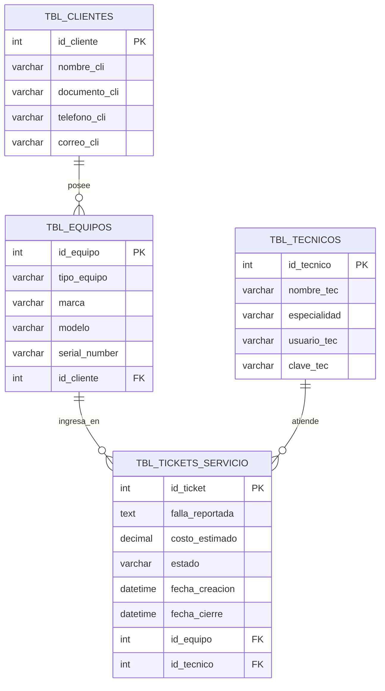
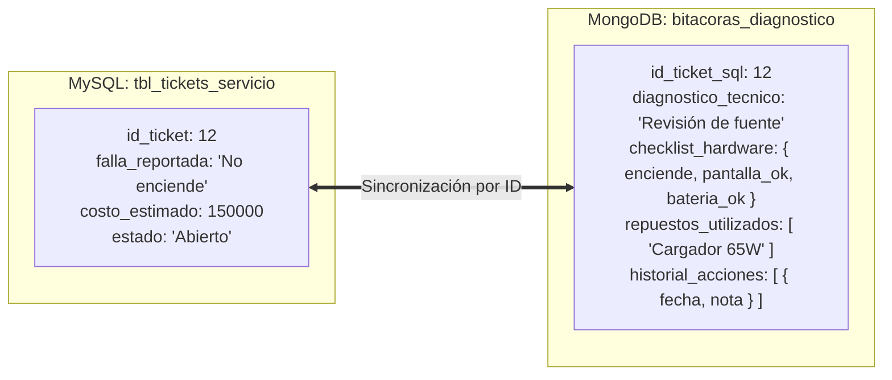

# Sistema de Gestión y Soporte Técnico TI


Aplicación de escritorio desarrollada en **Python** para la gestión integral de órdenes de servicio técnico, inventario de equipos y seguimiento de bitácoras de diagnóstico. Implementa una **arquitectura en capas** respaldada por un modelo de almacenamiento híbrido que combina la integridad referencial de **MySQL** con la flexibilidad documental de **MongoDB**.

---

## Arquitectura del Sistema y Flujo de Datos

El sistema separa las responsabilidades en cuatro capas independientes y sincroniza ambos motores de bases de datos mediante el identificador autoincremental generado al crear cada orden (`id_ticket_sql`).



---

## Modelo de Base de Datos Relacional (MySQL)

Almacena los datos maestros y transaccionales garantizando integridad referencial mediante llaves primarias (`PK`) y foráneas (`FK`):



---

## Modelo Documental e Integración Híbrida (MongoDB)

Para evitar rigidez estructural en los diagnósticos técnicos, cada orden registrada en MySQL se vincula con un documento flexible en la colección `bitacoras_diagnostico` mediante el campo `id_ticket_sql`:



### Estructura del Documento JSON en MongoDB
```json
{
  "id_ticket_sql": 12,
  "diagnostico_tecnico": "Revisión de fuente de poder",
  "checklist_hardware": {
    "enciende": false,
    "pantalla_ok": true,
    "bateria_ok": true
  },
  "repuestos_utilizados": [
    "Adaptador AC 65W"
  ],
  "historial_acciones": [
    {
      "fecha": "2026-11-25 14:30",
      "nota": "Ticket abierto y registrado en sistema."
    }
  ]
}
```

---

## Distribución de Datos y Automatización

### Responsabilidad por Motor
| Motor | Entidad / Colección | Tipo de Datos | Función en el Sistema |
| :--- | :--- | :--- | :--- |
| **MySQL** | `tbl_clientes` | Estructurados | Registro de propietarios, documentos de identidad y contacto. |
| **MySQL** | `tbl_tecnicos` | Estructurados | Personal de soporte, especialidad y credenciales de acceso. |
| **MySQL** | `tbl_equipos` | Estructurados | Inventario de hardware asociado a cada cliente. |
| **MySQL** | `tbl_tickets_servicio` | Transaccionales | Cabecera de la orden, falla, costo, estado y fechas de control. |
| **MongoDB** | `bitacoras_diagnostico` | Semiestructurados | Diagnóstico inicial, checklist variable, repuestos e historial técnico. |

### Objetos Programados en MySQL
| Objeto | Nombre | Tipo de Ejecución | Función Principal |
| :--- | :--- | :--- | :--- |
| **Procedimiento Almacenado** | `sp_crear_ticket` | Explícita (`cursor.callproc`) | Inserta la orden de servicio y devuelve el ID generado mediante un parámetro `OUT`. |
| **Vista SQL** | `vw_reporte_tickets` | Bajo demanda (`SELECT`) | Consolida mediante `INNER JOIN` los datos de la orden, equipo, cliente y técnico asignado. |
| **Trigger de Validación** | `trg_validar_costo` | Automática (`BEFORE INSERT`) | Bloquea el registro de órdenes con costos negativos lanzando una excepción hacia Python. |
| **Trigger de Cierre** | `trg_fecha_cierre` | Automática (`BEFORE UPDATE`) | Detecta cuando el estado cambia a `'Cerrado'` y asigna automáticamente la fecha actual (`NOW()`). |

---

## Estructura del Proyecto

```text
mesa_ayuda_proyecto/
├── config/
│   ├── conexion_mysql.py       # Parámetros y gestión de conexión TCP hacia MySQL
│   └── conexion_mongo.py       # Conexión al servidor local de MongoDB (PyMongo)
├── models/
│   ├── gestion_sql.py          # Operaciones CRUD parametrizadas para clientes, técnicos y equipos
│   └── gestion_poliglota.py    # Orquestación de operaciones entre MySQL y MongoDB ($push / find_one)
├── ui/
│   └── ventana_principal.py    # Interfaz gráfica POO con gestor de vistas (ttk.Notebook) y ficha técnica
├── .gitignore                  # Exclusión de entornos virtuales (.venv) y archivos temporales
├── main.py                     # Punto de arranque único de la aplicación
└── README.md                   # Documentación del repositorio
```

---

## Instalación y Ejecución

### 1. Requisitos Previos
* **Python 3.10** o superior.
* Servidor **MySQL** activo con el esquema, vista, procedimiento y triggers cargados.
* Servidor **MongoDB** activo en `localhost:27017`.

### 2. Clonar el Repositorio e Instalar Dependencias
```bash
git clone [https://github.com/TU_USUARIO/TU_REPOSITORIO.git](https://github.com/TU_USUARIO/TU_REPOSITORIO.git)
cd TU_REPOSITORIO

# Crear y activar entorno virtual (opcional)
python3 -m venv .venv
source .venv/bin/activate  # En Windows: .venv\Scripts\activate

# Instalar conectores de bases de datos
pip install mysql-connector-python pymongo
```

### 3. Configurar Credenciales y Ejecutar
Ajusta las credenciales locales en `config/conexion_mysql.py` y `config/conexion_mongo.py`, y ejecuta el punto de entrada:
```bash
python3 main.py
```

---

## Autores

* **Tomas Alvarez Cano**
